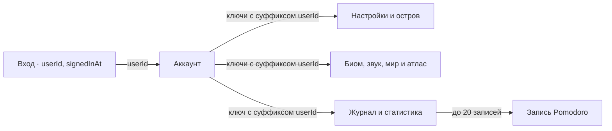
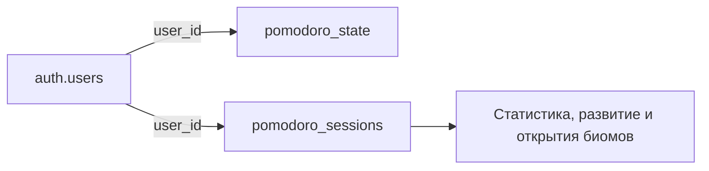
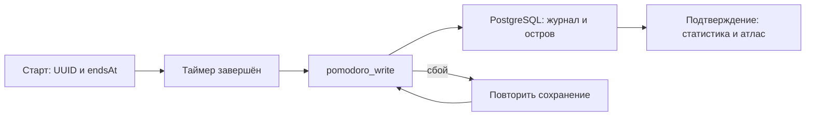

# Архитектура Pomodoro Island

## Общая структура и локальный режим

Vite отдаёт приложение на React и TypeScript. Экраны входа, таймера, прогресса и настроек используют shadcn/ui. Остров отрисовывается в SVG, оформление и анимации задаются CSS.

`AuthGate` читает локальную сессию входа, задаёт область хранения по ID аккаунта и монтирует `App`. Таймер создаётся в `App` над переключением маршрутов, поэтому продолжает работать при навигации. `useTimer` считает остаток по метке `endsAt`; пауза удерживает остаток, продолжение рассчитывает новую метку.

## Данные в локальном режиме

| Ключ localStorage | Содержание |
|---|---|
| `pomodoro.users.v1` | Аккаунты: ID, имя, email, соль, хеш пароля и дата создания |
| `pomodoro.auth.v1` | Текущая сессия входа: `userId` и `signedInAt` |
| `pomodoro.v1@<userId>` | Длительность, выключение звука, снимок острова |
| `pomodoro.biome.v1@<userId>` | Текущий биом |
| `pomodoro.audio.v1@<userId>` | Громкость и настройка запуска музыки |
| `pomodoro.world.v1@<userId>` | Время суток, погода, эффекты, анимации и звук мира |
| `pomodoro.atlas.v1@<userId>` | Сессии по биомам и показанные открытия |
| `pomodoro.sessions.v1@<userId>` | Накопительная статистика и последние 20 записей |



## От старта до записи в локальном режиме

1. [App.tsx](src/App.tsx) запоминает время старта и биом.
2. [useTimer.ts](src/hooks/useTimer.ts) считает остаток и вызывает обработчик при достижении нуля.
3. [App.tsx](src/App.tsx) записывает завершение, обновляет остров и атлас.
4. [useSessionLog.ts](src/hooks/useSessionLog.ts) создаёт ID, добавляет запись и обновляет статистику. [storage.ts](src/lib/storage.ts) сериализует журнал в JSON для текущего аккаунта.
5. [ProgressScreen.tsx](src/screens/ProgressScreen.tsx) отображает журнал и статистику.

```mermaid
flowchart TD
    A["Старт · App запоминает время и биом"] --> B["useTimer считает остаток по endsAt"]
    B --> C["Ноль · App обрабатывает завершение"]
    C --> D["useSessionLog обновляет журнал и статистику"]
    D --> E["storage сохраняет JSON в localStorage"]
    E --> F["Прогресс показывает запись"]
    C --> G["Остров достроен, показан баннер"]
```



Пример журнала с условными ID и временем:

```json
{
  "version": 1,
  "stats": { "completed": 1, "totalFocusMs": 60000 },
  "items": [
    {
      "id": "1795357200000-a1b2c3",
      "startedAt": "2026-11-22T13:00:00.000Z",
      "endedAt": "2026-11-22T13:01:00.000Z",
      "durationMinutes": 1,
      "elapsedMs": 60000,
      "biome": "meadow",
      "status": "completed"
    }
  ]
}
```

Время начала и окончания записывается в ISO. Пауза может увеличить разницу между ними. Для завершённой сессии `elapsedMs` равен выбранной длительности в миллисекундах. Только статус `completed` увеличивает накопительную статистику. Подтверждённый сброс может создать запись `aborted`. При чтении старой записи без ID идентификатор восстанавливается из дат.

## Ограничения локального режима

Данные привязаны к профилю браузера и адресу приложения. Очистка данных сайта удаляет их. Mock-вход разделяет данные в интерфейсе, а пользователь с доступом к браузеру может прочитать или подменить localStorage. Незавершённый отсчёт хранится в памяти и сбрасывается после перезагрузки. Снимок острова и уже записанные сессии сохраняются. Журнал, остров и атлас записываются отдельными операциями.

Следующий этап описан в [плане итоговой доработки](PLAN-IDZ1-FINAL.md).

## Подключаемый режим Supabase Auth

При наличии обеих переменных Supabase клиент получает сессию из SDK, а `AuthGate` подписывается на изменения входа. Подтверждение email использует одноразовый токен из ссылки, Google-вход — обмен кода PKCE. Без конфигурации используется прежний локальный режим. Для аккаунта Supabase приложение загружает начальное состояние из PostgreSQL до монтирования таймера. Старые ключи localStorage остаются в браузере. Переноса локальных аккаунтов или прогресса в PostgreSQL по умолчанию нет.

## Серверное хранение

| Таблица | Данные |
|---|---|
| `pomodoro_state` | Одна строка на `user_id`. Настройки таймера, звука и мира, снимок острова, текущий биом и поколение сброса. |
| `pomodoro_sessions` | История по `user_id` и UUID сессии. Время начала и конца, длительность, фактическое время фокуса, биом и статус. |

Обе таблицы ссылаются на `auth.users(id)`. Политики RLS ограничивают каждую операцию строками с `auth.uid() = user_id`. В браузере используются publishable key и сессия текущего пользователя. Индекс по владельцу, времени окончания и ID обслуживает журнал. PostgreSQL считает накопительную статистику и развитие биомов по всем завершённым строкам, а экран показывает последние 20 записей. Пороги открытия задаёт список биомов приложения.



При старте приложение создаёт UUID сессии. `pomodoro_write` блокирует строку состояния владельца и в одной транзакции добавляет запись, обновляет остров и возвращает снимок прогресса. Повтор с тем же UUID возвращает текущий снимок без повторного начисления. Сброс прогресса удаляет журнал и увеличивает поколение. Повтор старой записи после сброса не восстанавливает удалённую историю.



Интерфейс последовательно отправляет изменения. Настройки отображаются сразу, пока запись ожидает подтверждения. Журнал, статистика и карточка нового места обновляются после ответа. При сбое можно повторить очередь с теми же ID. Очередь держится в открытой вкладке. При закрытии с ожидающими операциями браузер предупреждает, если поддерживает такое предупреждение. Отсчёт живёт в памяти. Настройки и снимок острова синхронизируются при следующем открытии приложения. Одновременные изменения одного поля используют последнее записанное значение. Миграция лежит в `supabase/migrations/`.

### Контракт PostgreSQL и формат снимка

Все колонки обеих таблиц имеют `NOT NULL`. В `pomodoro_state` клиент передаёт `user_id uuid` (PK, FK). Остальные колонки имеют значения по умолчанию:

| Колонка | Тип | По умолчанию и поля |
|---|---|---|
| settings | jsonb | {}; необязательные ключи durationMinutes (целое), muted (boolean) |
| audio | jsonb | {}; volume (число), musicOnStart (boolean) |
| world | jsonb | {}; timeOfDay, weather, motion (строки), effects, ambienceOn, chime (boolean), ambienceVolume (число) |
| island | jsonb | progress=0, completedAt=null. В завершённом снимке progress=1, completedAt — строка времени |
| biome | text | meadow; ограничение на один из восьми ID |
| generation | integer | 0; целое неотрицательное поколение сброса |

Ключи внутри JSON могут отсутствовать. `decodeState`, `decodeAudio` и `decodeWorld` подставляют дефолты и нормализуют значения. Отсутствие всей строки состояния допустимо у нового аккаунта. При первой записи RPC создаёт строку.

В `pomodoro_sessions` все поля задаются при записи: `user_id uuid` (FK), `id uuid` (вместе с владельцем образует PK), `started_at timestamptz`, `ended_at timestamptz`, `duration_minutes integer` (1–180), `elapsed_ms integer` (0–длительность в мс), `biome text` (один из восьми), `status text` (`completed` или `aborted`). Конец сессии не раньше начала. Обе FK используют `ON DELETE CASCADE`. Индекс журнала — `(user_id, ended_at DESC, id DESC)`.

Облачный пример — форма ответа RPC для подтверждённой при проверке минутной сессии на лугу. UUID и даты заменены, чтобы пример не идентифицировал аккаунт или запись. В ответе журнала нет `user_id`.

```json
{
  "id": "00000000-0000-4000-8000-000000000001",
  "startedAt": "2026-11-22T13:00:00+00:00",
  "endedAt": "2026-11-22T13:01:00+00:00",
  "durationMinutes": 1,
  "elapsedMs": 60000,
  "biome": "meadow",
  "status": "completed"
}
```

### Загрузка, восстановление и ошибки

- `AuthGate` принимает события SDK и восстанавливает сессию. Формы поддерживают пароль, подтверждение адреса и восстановление по письму, а также Google OAuth. Callback обменивает PKCE-код или проверяет одноразовый токен. Повторная или недействительная ссылка обрабатывается на экране входа.
- `CloudApp` загружает `pomodoro_snapshot` перед открытием таймера. После перезагрузки или повторного входа подтверждённые записи загружаются заново. Это восстановление состояния аккаунта, а не восстановление удалённой истории или резервной копии.
- `App` управляет отсчётом, островом и звуком, передаёт данные через `AppStateContext`. `useCloudProgress` отправляет записи последовательно. При ошибке загрузки и сохранения доступны отдельные действия повтора. Ошибка записи оставляет очередь во вкладке до подтверждения.
- RPC работают с правами вызывающего пользователя. Для роли authenticated есть раздельные политики SELECT, INSERT, UPDATE и DELETE. Неавторизованная роль не имеет разрешений на таблицы и RPC. Браузер получает publishable key, права на строки определяются сессией.

Схема SQL и RPC: [миграция](supabase/migrations/20261122190000_pomodoro_progress.sql). Клиент: [cloudProgress.ts](src/lib/cloudProgress.ts), [useCloudProgress.ts](src/hooks/useCloudProgress.ts).
